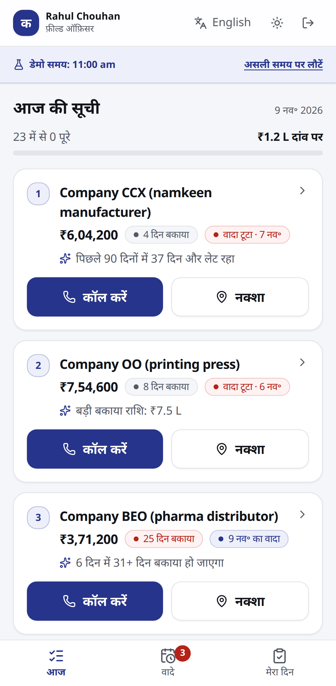
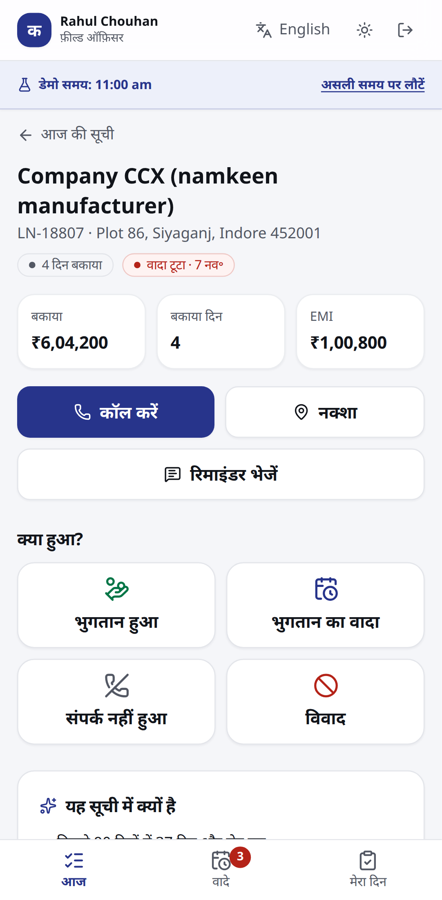
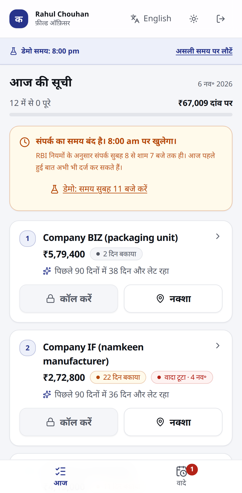
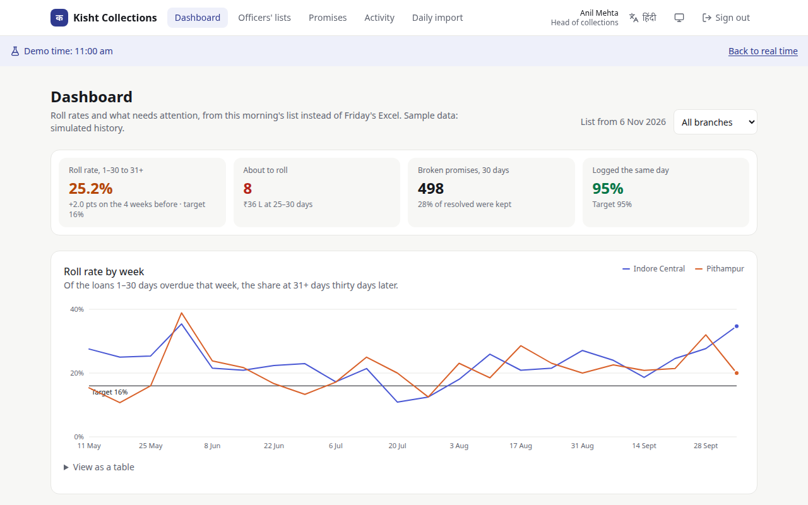

# Kisht Collections

A field collections app for an MSME lender (an RBI-registered NBFC in Indore). Each morning, field officers open the app and see which overdue borrowers matter most today and why. They log what happened (paid, promise to pay, not reachable, dispute) in three taps, even with no signal. Branch managers see promises and roll rates by branch the same day, instead of waiting for Friday's Excel.

- **Priority score with reasons.** A small trained model estimates the chance that each loan rolls from 1–30 into 31+ DPD. Each loan is ranked by the expected rupee loss we can still avoid, and shows the top three reasons. The score is advisory: managers can reorder any list, and a weekly back-test checks it against what borrowers actually paid.
- **Offline first.** Outcomes and contact attempts go to an on-device outbox and sync when there's signal. Each event carries an idempotency key, so retries never create duplicates.
- **Contact window.** RBI recovery rules allow contact only between 8 am and 7 pm, so the app blocks calls and visits outside that window. The server checks again using the time the action happened (corrected for device clock skew), and every attempt is recorded, blocked ones included.

> **Live:** <https://kist-collection.duckdns.org>. Demo logins are in [deployment.md](deployment.md), and the design is in the [technical design document](docs/TDD.pdf).

<p>
  
  
  
</p>
<p>
  
</p>

See [docs/ASSUMPTIONS.md](docs/ASSUMPTIONS.md) and [docs/DECISIONS.md](docs/DECISIONS.md).

## Stack

| Layer    | Choice                                                                                         |
| -------- | ---------------------------------------------------------------------------------------------- |
| Web      | Next.js 16 (App Router), a PWA. The officer UI is built for phones, the manager UI for desktop |
| API      | Fastify 5, routes typed by shared zod contracts                                                |
| Database | PostgreSQL 16, Prisma 7 (pg driver adapter)                                                    |
| Auth     | Better Auth (email and password), roles `OFFICER`, `BRANCH_MANAGER` and `HEAD`                 |
| Offline  | Dexie (IndexedDB) outbox and a service worker                                                  |
| Tests    | Vitest; Playwright for the offline flow                                                        |

## Repository layout

```
apps/
  api/        Fastify API: modules/{auth,imports,loans,me,...}, each routes.ts + service.ts
  web/        Next.js app: features/{session,field,offline,manager,...}; /api/* is rewritten to the API
packages/
  domain/     Pure business rules (IST dates, contact window, promises, assignment,
              CSV parsing, import planning, roll rate). No I/O, shared by web and API.
  contracts/  Zod schemas for every API request and response (one wire format)
  db/         Prisma schema, migrations, client, provisioning, deterministic seed
deploy/       Docker images, compose file and Caddy config for the server
docs/         Architecture, assumptions, decisions, model card, requirements, TDD
e2e/          Playwright tests (phone and desktop)
```

See [docs/ARCHITECTURE.md](docs/ARCHITECTURE.md) for diagrams and the dependency rule. With the API running, the OpenAPI docs are at <http://localhost:3000/api/docs>.

## Run locally

Requirements: Node 22, pnpm 12, Docker.

```bash
cp .env.example .env
pnpm install
pnpm db:up        # Postgres 16 on host port 5433 (set POSTGRES_PORT to change)
pnpm db:migrate    # applies committed migrations (prisma migrate deploy)
pnpm db:seed
pnpm dev          # web on http://localhost:3000, API on http://localhost:4000
```

```bash
pnpm lint
pnpm typecheck
pnpm test          # unit + API integration tests (uses the kisht_test database)
pnpm e2e           # browser tests on phone and desktop; needs a seeded DB and a web build:
                   # pnpm db:seed && pnpm --filter @kisht/web build && pnpm e2e
```

### Quality gates

CI fails if any of these slip: Biome lint and package boundaries, strict TypeScript, unit and API tests, 90% coverage on the business rules, and Playwright on phone and desktop, including real offline runs and WCAG 2.1 AA (axe) on every screen in both themes.

### Demo mode

With `DEMO_MODE=true` and `NEXT_PUBLIC_DEMO_MODE=true` (the defaults in `.env.example`), the sign-in page offers one-tap demo accounts, and the import screen offers **Download today's sample export**: the latest overdue list with a few realistic changes (three loans paid off, two part-payments, a new loan and one bad row), so an upload exercises every part of the preview. Every demo account uses the password in `DEMO_PASSWORD`.

Tests that touch the database use the separate `kisht_test` database, which docker-compose creates on first start. Apply migrations to it with `pnpm db:migrate:test`.

To change the schema, edit `packages/db/prisma/schema.prisma` and run `pnpm db:migrate:dev` in an interactive terminal.

### Troubleshooting

- **Port 5432 already in use.** The compose file maps Postgres to host port 5433 by default. If you change `POSTGRES_PORT`, update the URLs in `.env` to match.
- **`pnpm dev` fails with "Too many open files" (EMFILE / os error 24).** Your machine has run out of inotify instances (editors use many). Raise the limit with `sudo sysctl fs.inotify.max_user_instances=512`. Or run without file watchers: `pnpm --filter @kisht/api start` and `pnpm --filter @kisht/web build && pnpm --filter @kisht/web start`.
