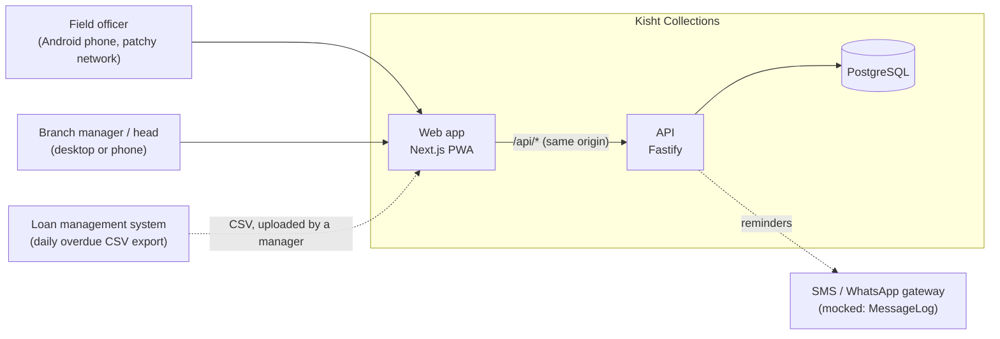
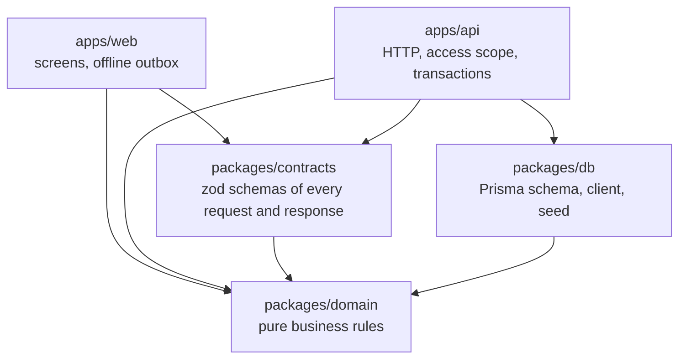
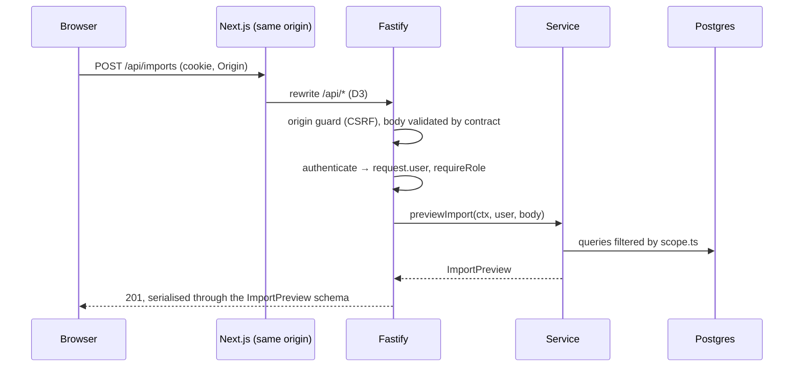
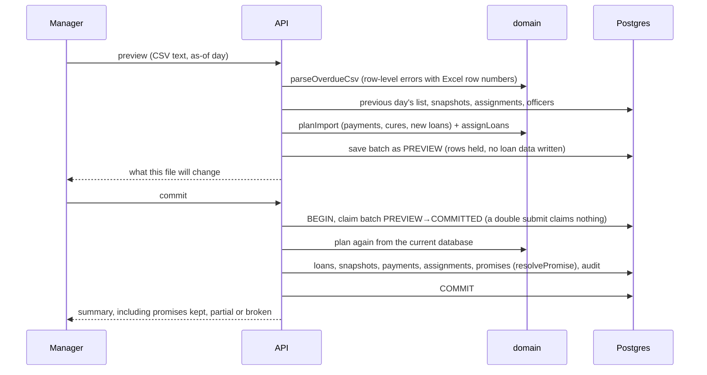

# Architecture

Kisht Collections is a modular monolith: one API, one web app, and three small packages with one job each. Every business rule exists exactly once, every API response has one schema that both sides use, and CI fails if the packages start depending on each other in the wrong direction.

## System context



## Packages and the dependency rule



| Package     | Owns                                                                                                                                                                 | May not import                        |
| ----------- | -------------------------------------------------------------------------------------------------------------------------------------------------------------------- | ------------------------------------- |
| `domain`    | Dates in IST, contact window (RBI 8 am–7 pm), promise resolution, assignment, CSV parsing, import planning, roll rate, phone masking, and (day 3) the priority model | db, contracts, any framework, any I/O |
| `contracts` | The wire format: request and response schemas, plus enums                                                                                                            | db, servers, UI frameworks            |
| `db`        | Schema and migrations, the client, user provisioning, the deterministic seed                                                                                         | apps                                  |
| `api`       | Auth, access scope, HTTP, transactions                                                                                                                               | the web app                           |
| `web`       | Screens, i18n, and (day 4) the offline outbox                                                                                                                        | **the database**                      |

These rules are enforced by Biome's `noRestrictedImports` (see `biome.json`), so a violation fails `pnpm lint` and CI. Because `domain` is pure, the phone and the server run the _same_ contact-window and promise code: the button an officer sees disabled is exactly what the server would reject.

## Inside the API

```
apps/api/src
  app.ts            composition root: builds the AppContext, registers every module
  context.ts        AppContext { prisma, auth, clock, config, authenticate }
  http/             errors (HttpError, error handler), guards (session, role), origin check
  modules/
    auth/           Better Auth bridge, scope.ts (the one access-control module)
    audit/          append-only audit log
    health/ me/ loans/ imports/
      routes.ts     HTTP only: guards + contract schemas, then calls the service
      service.ts    logic and Prisma, returns contract types
```

- **One access-control module.** `modules/auth/scope.ts` turns a user into a `Scope` (an officer's current assignments, some branches, or all), and every loan, officer and import-batch query takes its `where` from there. Out of scope looks exactly like not found (404), so ids can't be probed.
- **Contracts at the edge.** Routes declare `schema: { params, body, response }` from `@kisht/contracts` through `fastify-type-provider-zod`. Inputs are validated before the handler runs; responses are serialised _through_ their schema, so a field that isn't in the contract (a borrower's phone, say) can't leak. A response that breaks its contract becomes a logged 500, never a malformed reply. The web parses responses with the same schemas. OpenAPI docs are generated from them at `/api/docs`.
- **Explicit dependencies.** Modules get everything through `AppContext`; nothing reaches for a global. Tests build the whole app with a pinned clock and call it with `app.inject()`.

## Request path



## Daily import: preview, then commit



## Offline logging (day 4)

The officer app writes every call or visit attempt and every outcome to an on-device outbox (IndexedDB) as an append-only event with a client UUID. Sync is an idempotent batch upsert keyed by that UUID, judged by the time the event happened (corrected for device clock skew), not when it arrived. This section gets its sequence diagram when the sync endpoint lands.

## Testing

| Layer                                       | What it proves                                                                                                 | Where                               |
| ------------------------------------------- | -------------------------------------------------------------------------------------------------------------- | ----------------------------------- |
| Domain unit tests (≥ 90% coverage enforced) | Every business rule, with boundary cases such as 18:59:59 vs 19:00:00 and the 90% promise line                 | `packages/domain/src/*.test.ts`     |
| Database tests                              | Partial unique indexes (one current officer and one pending promise per loan), date round-trips                | `packages/db/test`                  |
| Seed tests                                  | Determinism, the brief's sample rows reproduced exactly, roll rate ≈ 22%                                       | `packages/db/test/simulate.test.ts` |
| API integration tests                       | Access scope per role, CSRF, sign-up closed, contract guarantees, import preview/commit/re-upload/out-of-order | `apps/api/test`                     |
| Browser tests (phone + desktop)             | Sign-in routing and the full import flow on the demo data                                                      | `e2e/`                              |
